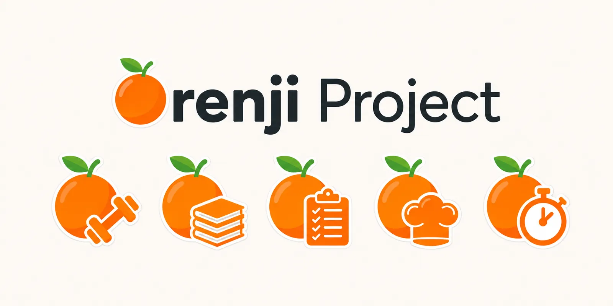

# 🍊 Orenji Project — Landing Page

> Aplicações simples para uma vida mais organizada, saudável e equilibrada — fáceis como descascar uma laranja.



Site estático (HTML + CSS + JS, sem ferramental de build) com:

- **Design System Orenji** — paleta (Laranja `#FF7A00`, Verde Folha, Creme, neutros cinza), tipografia **Poppins** self-hosted, variantes claro/escuro.
- **Ecossistema de apps** em tiles de ícones (estilo *home screen*) que abrem num **modal pop-up** com detalhes e estado por app.
- **Bilingue**: PT (raiz) e EN (`en/index.html`), com seletor no menu e `hreflang`.
- **SEO básico**: Open Graph/Twitter cards, canonical, JSON-LD, `sitemap.xml`, `robots.txt`.

---

## 📁 Estrutura

```
.
├── index.html          # página em português (raiz)
├── en/index.html       # página em inglês
├── styles.css          # design system + componentes (tokens claro/escuro)
├── script.js           # dados das apps + tiles + modal (fonte única de dados)
├── assets/
│   ├── fonts/          # Poppins 400/500/600/700 (woff2, subset latin)
│   ├── orenji-logo.*   # logótipo principal (sticker)
│   ├── fitness-logo.webp · study-logo.webp · recipes-logo.webp
│   ├── focus-logo.webp · habit-logo.webp
│   ├── orenji-banner.webp   # composição wordmark + ícones (hero)
│   ├── og-cover.jpg         # imagem 1200×630 para partilha social
│   └── favicon-32.png · apple-touch-icon.png · icon-192.png · icon-512.png
├── links.json          # índice standalone das apps (para outros das plataformas)
├── sitemap.xml · robots.txt · site.webmanifest
```

## 👀 Pré-visualização local

```bash
python3 -m http.server 8000
# abrir http://localhost:8000
```

## 🚀 Estrutura de branches

- `main` — produção (não editar diretamente).
- `landing-page-v1` — redesign atual (**merge para a main via PR**, depois de rever a pré-visualização).

## 🧩 Como adicionar uma nova app

1. Colocar o logótipo em `assets/<id>-logo.webp` (gera WebP a partir do PNG com Pillow: `Image.open(...).save(..., "WEBP", quality=82)`).
2. Adicionar um objeto ao array `APPS` no topo de `script.js` (id, name, icon, accent, status, url, tagline e description em `pt`/`en`).
3. Acolher o tile e o modal surgem automaticamente.
4. Atualizar `links.json` com a mesma informação.

## 🚦 Como publicar uma app (de "Em briefe" para live)

- Repos privados → tiles em estado **"Em briefe"** (chip, sem link).
- Quando o repositório ficar público (GitHub Pages ativo): em `script.js`, mudar `status: "soon"` para `"live"` **e confirmar o `url`**. O chip desaparece e o CTA "Abrir app →" entra automaticamente.
- Atualizar `links.json` e, se for uma app nova, a imagem hero (`banner novo.png` no repo `orenji-docs/branding`).

## 🎨 Design System (resumo)

| Token (claro)              | Hex       |
| -------------------------- | --------- |
| Laranja Orenji             | `#FF7A00` |
| Verde Folha                | `#43836A` |
| Creme (fundo página)       | `#FFF3E3` |
| Cinza 900 (texto)          | `#111827` |
| Cinza 500 (muted)          | `#6B7280` |
| Cinza 300 (bordas)         | `#D1D5DB` |
| Cinza 100                  | `#F3F4F6` |

Tema escuro: fundo `#0F1319`, superfícies `#1A1F28`, bordas `#2A2F37`, texto `#E5E7EB`, Verde Folha `#4CAF50`.

Tipografia: **Poppins** (400/500/600/700) em `assets/fonts/` — títulos Bold, corpo Regular.

Acentos por app: Fitness `#FF7A00` · Study `#3B82F6` · Recipes `#F59E0B` · Focus `#43836A` · Habit `#A855F7`.

## 🔎 Notas de publicação

- Os URLs `canonical` / OG assumem o GitHub Pages do repo: `https://orenji-project.github.io/Orenji-project-landing-page/`. Se o site for publicado noutro endereço (ex.: domínio próprio ou raiz da organização), atualizar: `index.html` + `en/index.html` (canonical, OG, JSON-LD), `sitemap.xml` e `robots.txt`.
- `links.json` não é usado pela página — é um índice independente para outros projetos do Orenji.
